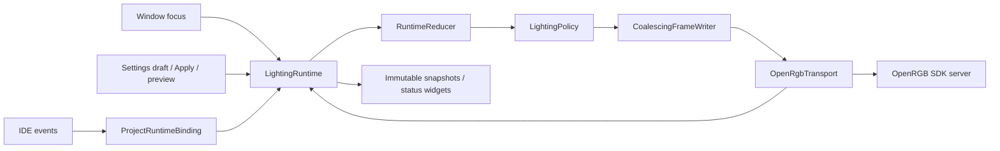

# KGBoard - RGB подсветка клавиатуры для IntelliJ IDEA

## Описание проекта

**KGBoard** - это плагин для IntelliJ IDEA и других IDE на базе IntelliJ Platform, который обеспечивает визуальную обратную связь через RGB подсветку клавиатуры. Плагин отображает различные события IDE (компиляция, тестирование, запуск, отладка) в виде цветовых эффектов на RGB клавиатуре.

### Что умеет плагин

- **Компиляция (Build)**:
  - Желтая пульсация во время компиляции
  - Зеленая вспышка при успешной сборке
  - Красный статический цвет при ошибках сборки
  - Отмена снимает слой сборки без сигнала успеха

- **Тестирование (Testing)**:
  - Синяя пульсация во время запуска тестов
  - Зеленая вспышка при успешном прохождении всех тестов
  - Красный статический цвет при провале тестов

- **Выполнение (Execution)**:
  - Зеленый статический цвет при запуске приложения (Run)
  - Фиолетовая пульсация при отладке (Debug)
  - Оранжевая вспышка при ошибке выполнения (ненулевой exit code)
  - Возврат к цвету покоя при нормальном завершении

- **Фокус и жизненный цикл IDE**:
  - Затемнение клавиатуры при потере фокуса IDE (настраиваемая яркость)
  - Восстановление текущего эффекта при возврате фокуса
  - Сброс LED в чёрный при закрытии IDE
  - Закрытие проекта снимает только принадлежащие ему состояния

- **Статус в реальном времени**:
  - Виджет в статус-баре IDE с индикацией подключения к OpenRGB
  - Автоматическое переподключение при потере соединения
  - Обнаружение всех RGB устройств, подключенных через OpenRGB

### Технологии

- **OpenRGB SDK** - кросс-платформенное управление RGB подсветкой различных производителей
- **Kotlin** - язык разработки плагина
- **IntelliJ Platform SDK** - платформа для создания плагинов
- **TCP Socket** - протокол связи с OpenRGB SDK сервером

---

## Архитектура

Единственный application-level `LightingRuntimeService` владеет состоянием и выводом.
Проектные адаптеры сообщают факты; reducer последовательно обрабатывает их, policy
вычисляет кадры, а отдельный сетевой worker отправляет их в OpenRGB.



Подсветкой управляет активное окно проекта. Фоновые проекты сохраняют свои факты,
но не записывают LED; закрытие фонового проекта не сбрасывает активный. При потере
фокуса затемнение применяется поверх всех эффектов, а возврат восстанавливает текущий кадр.

Run/Debug/Build/Test имеют отдельные идентификаторы. Завершение одной операции открывает
сохранившиеся нижние слои. Отмена, несостоявшийся запуск и ноль выполненных тестов
не показывают зелёный успех. Терминальные эффекты живут `effectDurationMs` для всех целей.
Build наблюдается через `ProjectTaskListener`; самостоятельные external-system задачи
за пределами `ProjectTaskManager` в этой версии не отслеживаются.

Анализ и TODO относятся к выбранному текстовому документу. Смена вкладки, изменение текста,
закрытие или удаление файла сразу инвалидируют предыдущий результат. Неизвестный анализ,
индексация, неподходящий редактор и подтверждённый результат различаются в статусе.

Настройки редактируют отдельный черновик. Apply валидирует его целиком и публикует один
снимок; Cancel сохраняет прежнюю конфигурацию. Connect использует текущие host/port;
после Cancel диагностическое подключение возвращается к исходному намерению и endpoint.
После Apply следующий Cancel возвращается к уже применённой конфигурации. Явный Disconnect
сохраняет ручное отключение. Preview использует сценарий, устройство и цель черновика;
закрытие диалога, Disable, смена устройства и Disconnect снимают предпросмотр.
Неподтверждённые числовые индексы сохраняются неактивными до проверки диапазона и раскладки.

Статичные кадры не держат цикл анимации. У каждого устройства свой кеш успешной отправки;
новый кадр заменяет ожидающий. Ошибка I/O закрывает сессию, retry использует задержки
1–30 секунд. Ручной Disconnect отменяет retry. Раз в 5 секунд worker проверяет соединение
и состав устройств; изменение геометрии запускает новую сессию и перестраивает раскладку.

Shortcut-контексты `debug` и `search` включаются по живым debug sessions, Search Everywhere
и поиску в редакторе. `editing`/`vcs` сохраняют настройки и явный API активации;
автоматическое определение этих контекстов не реализовано. Git сохраняет прежнюю семантику
индикаторов: различие локального и tracked remote hash считается «unpushed» без определения направления расхождения.

## Требования

### Системные требования

- **Операционная система**: Ubuntu 20.04+ (или другой Linux дистрибутив с поддержкой OpenRGB)
- **JDK**: Java 25
- **IntelliJ IDEA**: 2026.3 (build 263.*)
- **OpenRGB**: версия 0.9+ с включенным SDK сервером
- **Права доступа**: udev rules для доступа к USB HID устройствам без sudo

### Совместимые RGB устройства

Плагин работает с любыми RGB устройствами, поддерживаемыми OpenRGB:
- Клавиатуры (Corsair, Razer, Logitech, HyperX, SteelSeries и др.)
- Мыши
- Подсветка корпуса (RGB контроллеры, вентиляторы, LED ленты)
- Оперативная память с RGB
- Материнские платы

Полный список поддерживаемых устройств: https://openrgb.org/devices.html

---

## Установка и настройка OpenRGB на Ubuntu

### 1. Установка OpenRGB

#### Вариант 1: AppImage (рекомендуется)

```bash
# Скачать последнюю версию
wget https://openrgb.org/releases/release_0.9/OpenRGB_0.9_x86_64_b5f46e3.AppImage -O ~/OpenRGB.AppImage

# Сделать исполняемым
chmod +x ~/OpenRGB.AppImage

# Запустить
~/OpenRGB.AppImage
```

#### Вариант 2: Установка из пакета

```bash
# Добавить PPA (для Ubuntu)
sudo add-apt-repository ppa:thopiekar/openrgb
sudo apt update

# Установить OpenRGB
sudo apt install openrgb
```

#### Вариант 3: Сборка из исходников

```bash
# Установить зависимости
sudo apt install build-essential qtbase5-dev libusb-1.0-0-dev libhidapi-dev pkgconf

# Клонировать репозиторий
git clone https://gitlab.com/CalcProgrammer1/OpenRGB.git
cd OpenRGB

# Собрать
qmake OpenRGB.pro
make -j$(nproc)

# Запустить
./openrgb
```

### 2. Настройка udev rules (ОБЯЗАТЕЛЬНО!)

Без udev rules OpenRGB требует запуск с `sudo`, что небезопасно и неудобно.

```bash
# Создать директорию для правил, если её нет
sudo mkdir -p /etc/udev/rules.d

# Скопировать правила из OpenRGB
sudo wget https://openrgb.org/releases/release_0.9/60-openrgb.rules -O /etc/udev/rules.d/60-openrgb.rules

# Или если OpenRGB уже установлен:
sudo cp /usr/share/OpenRGB/60-openrgb.rules /etc/udev/rules.d/

# Перезагрузить udev правила
sudo udevadm control --reload-rules
sudo udevadm trigger

# Добавить текущего пользователя в группу plugdev
sudo usermod -a -G plugdev $USER

# ВАЖНО: Выйти и войти заново, или перезагрузиться
```

После перезагрузки проверьте, что OpenRGB запускается без sudo и видит устройства.

### 3. Включение SDK сервера

KGBoard взаимодействует с OpenRGB через SDK сервер, работающий по TCP на порту 6742.

#### Включение через GUI:

1. Запустить OpenRGB
2. Перейти в **Settings** → **SDK Server**
3. Включить **Enable SDK Server**
4. Порт по умолчанию: `6742` (не менять, если не требуется)
5. Опционально: включить **Auto-start SDK Server** для автозапуска при старте OpenRGB
6. Нажать **Save**

#### Включение через CLI:

```bash
# Запустить OpenRGB в режиме сервера (без GUI)
openrgb --server --server-host 127.0.0.1 --server-port 6742 --noautoconnect

# Или через AppImage
~/OpenRGB.AppImage --server --server-host 127.0.0.1 --server-port 6742 --noautoconnect
```

#### Автозапуск OpenRGB SDK при старте системы (опционально)

Создать systemd service для автозапуска:

```bash
# Создать service file
cat > ~/.config/systemd/user/openrgb.service << 'EOF'
[Unit]
Description=OpenRGB SDK Server
After=graphical-session.target

[Service]
Type=simple
ExecStart=/usr/bin/openrgb --server --server-host 127.0.0.1 --server-port 6742 --noautoconnect
Restart=on-failure

[Install]
WantedBy=default.target
EOF

# Включить и запустить service
systemctl --user enable openrgb.service
systemctl --user start openrgb.service

# Проверить статус
systemctl --user status openrgb.service
```

Если используется AppImage:

```bash
# Заменить ExecStart на:
ExecStart=/home/YOUR_USERNAME/OpenRGB.AppImage --server --server-host 127.0.0.1 --server-port 6742 --noautoconnect
```

### 4. Проверка работы OpenRGB SDK

```bash
# Проверить, что SDK сервер слушает порт 6742
netstat -tulpn | grep 6742

# Или
ss -tlnp | grep 6742

# Должен вывести что-то вроде:
# tcp  0  0  127.0.0.1:6742  0.0.0.0:*  LISTEN  12345/openrgb
```

Если порт не слушается - SDK сервер не запущен. Вернитесь к шагу 3.

---

## Сборка плагина

### Сборка из исходников

```bash
# Перейти в директорию проекта
cd /home/dzerik/Development/KGBoard

# Сборка плагина (создаёт ZIP архив в build/distributions/)
./gradlew buildPlugin

# Результат:
# build/distributions/KGBoard-<version>.zip
```

### Запуск IDE с плагином для разработки

```bash
# Запустить IntelliJ IDEA с установленным плагином (для тестирования)
./gradlew runIde

# Откроется новый экземпляр IntelliJ IDEA с активным плагином KGBoard
```

### Другие полезные команды

```bash
# Очистка build артефактов
./gradlew clean

# Проверка плагина на совместимость с Platform API
./gradlew verifyPlugin

# Сборка + проверка
./gradlew buildPlugin verifyPlugin
```

---

## Установка плагина в IDE

### Вариант 1: Установка из ZIP архива (рекомендуется)

1. Собрать плагин (см. раздел "Сборка плагина")
2. Открыть IntelliJ IDEA
3. Перейти в **File → Settings → Plugins**
4. Нажать на иконку шестеренки (⚙️) → **Install Plugin from Disk...**
5. Выбрать файл `build/distributions/KGBoard-<version>.zip`
6. Нажать **OK**
7. Перезапустить IDE

### Вариант 2: Запуск через Gradle (для разработки)

```bash
# Запустить sandbox IDE с плагином
./gradlew runIde
```

Этот метод создаёт изолированную среду со всеми настройками в `.intellijPlatform/sandbox/KGBoard/IU-2026.3/`, не затрагивая основную установку IDE.

---

## Настройка плагина

Откройте **Settings → Tools → KGBoard RGB** или найдите действие **KGBoard RGB Settings**
через Find Action (`Ctrl+Shift+A`). Первое подключение:

1. Включите **Enable KGBoard**, нажмите **Apply**, затем **Connect**.
2. Выберите реальное устройство и нажмите **Identify device**: белый свет на 30% яркости
   на две секунды помогает проверить выбор. Первое явное выделение добавляет назначение
   только в черновик; **Cancel** его отменяет.
3. Во вкладке **Lighting scenarios** выберите состояние, цвет и **Lighting target**,
   проверьте **Preview** и нажмите **Apply** для сохранения назначения и правил.

В приложении четыре раздела: устройства и роли, сценарии, Pomodoro, дополнительные
параметры. Сервер и порт находятся в сворачиваемом блоке **Server settings**.
Проектная страница **KGBoard RGB (Project)** содержит Git, анализ и подсказки сочетаний
клавиш. Она относится к указанному в заголовке проекту; переключение активного окна
не переносит редактирование в другой проект. Apply и Cancel действуют в своей области.

Каждое состояние настраивается отдельно: например, сборка в процессе, успех, ошибка,
отмена и отсутствие запуска. Preview использует текущий черновик и показывает причину,
если устройство или цель недоступны. Закрытие страницы, Disconnect и Disable снимают
её предпросмотр. Preview не проверяет наличие реального события IDE.

### Устройства и цели

Роли **All events**, **The same events on another device**, **Indicators only** и
**Background lighting** выбирают, какие события получает устройство. Для смены роли
выберите сохранённое назначение и нажмите **Replace selected assignment**. Отсутствующие,
неоднозначные и неактивные назначения видны в списке; удаление меняет только черновик.
После reconnect устройство определяется по сохранённой идентичности, а не старому индексу.
Устройства без надёжной идентичности требуют повторного подтверждения.

Цели: все LED, именованные LED, пользовательская группа либо индексы в расширенном
режиме. Поиск фильтрует полный список имён, не снимая скрытое выделение. Имена, которые
OpenRGB сообщает как `Keyboard LED 0…125`, не означают физические клавиши: плагин не
угадывает раскладку. Индексы требуют **Confirm layout** для текущего устройства;
изменение геометрии делает подтверждение недействительным. Ошибка цели не включает все LED.

Группы имеют постоянный UUID: переименование сохраняет ссылки, удаление переводит
ссылающиеся цели черновика в неназначенные. Встроенные группы менять нельзя. Для
веток Git доступны порядок правил, проверка regex и цвета до сохранения.

### Совместимость OpenRGB

Запускайте один OpenRGB и оставляйте одного производителя кадров на управляемое
устройство. Обычный OpenRGB поддерживает сервер без GUI:

```bash
openrgb --server --server-host 127.0.0.1 --server-port 6742 --noautoconnect
```

`--noautoconnect` отключает исходящие подключения самого OpenRGB. Это не блокировка
устройства: SDK не предоставляет плагину эксклюзивного владения или гарантированного
восстановления чужой анимации. Приостановите другой софт, который пишет в те же LED.

Для программных анимаций нужен подходящий режим устройства. **Custom** может мерцать
или сохранять изменения в память; **Direct** предназначен для потока кадров. Например,
проверенный EVision `0C45:5004` сообщает Custom/AutoSave, но не Direct. Плавные встроенные
волны, радуга и дыхание исполняются прошивкой и не доказывают поддержку потока Custom.
Исправления парсера и жизненного цикла плагина не гарантируют устранение аппаратного
мерцания. Подробности: [описание режимов OpenRGB](https://github.com/CalcProgrammer1/OpenRGB/blob/master/Documentation/Common-Modes.md).

### Хранение и проверка

Приложение сохраняет `options/kgboard.xml` и группы в системном каталоге настроек IDE,
проект — собственные настройки проекта. Старые значения мигрируют в версионированные
правила; неизвестные записи сохраняются неактивными. Настраивайте цели через UI:
правка устаревшего `deviceIndex` больше не подтверждает назначение устройства.

Реальные UI-тесты запускаются с отдельными путями IDEA и тестовым SDK, без доступа к
рабочему OpenRGB. На Linux требуются Xvfb и openbox или twm:

```bash
tools/run-ui-tests.sh integrationTest -PlocalPlatformPath=/path/to/idea --console=plain
```

Матрица интерфейса: Light/Dark, 100/150/200%, окна 900×700 и 1200×900. Снимки —
`build/reports/kgboard-ui/`. `KGBOARD_UI_CASE=dark-200` выбирает тему/масштаб с проверкой обоих размеров окна.

## Troubleshooting (Решение проблем)

### 1. Плагин не подключается к OpenRGB

**Симптомы:**
- Статус виджет показывает "RGB: OFF"
- В настройках статус "Not connected"

**Причины и решения:**

#### a) OpenRGB SDK сервер не запущен

```bash
# Проверить, запущен ли OpenRGB
ps aux | grep openrgb

# Проверить, слушается ли порт 6742
netstat -tlnp | grep 6742
```

**Решение:**
```bash
# Запустить OpenRGB с SDK сервером
openrgb --server --server-host 127.0.0.1 --server-port 6742 --noautoconnect
```

#### b) Неправильный хост или порт

**Решение:**
- Открыть **Settings → Tools → KGBoard RGB**
- Проверить **OpenRGB host**: должен быть `127.0.0.1` (если OpenRGB на той же машине)
- Проверить **OpenRGB port**: должен быть `6742`
- Нажать **Connect**

#### c) Firewall блокирует подключение

```bash
# Проверить правила firewall
sudo ufw status

# Разрешить локальные подключения (если нужно)
sudo ufw allow from 127.0.0.1 to any port 6742
```

### 2. OpenRGB не видит устройства

**Симптомы:**
- OpenRGB запускается, но показывает 0 устройств
- Требует запуск через `sudo`

**Причины и решения:**

#### a) Не настроены udev rules

**Решение:** См. раздел "Настройка udev rules"

```bash
# Скачать и установить правила
sudo wget https://openrgb.org/releases/release_0.9/60-openrgb.rules -O /etc/udev/rules.d/60-openrgb.rules

# Перезагрузить udev
sudo udevadm control --reload-rules
sudo udevadm trigger

# Добавить пользователя в группу
sudo usermod -a -G plugdev $USER

# ОБЯЗАТЕЛЬНО: выйти и войти заново или перезагрузиться
```

#### b) Устройство не поддерживается OpenRGB

Проверить список поддерживаемых устройств: https://openrgb.org/devices.html

### 3. Permission denied при запуске OpenRGB

**Ошибка:**
```
Error: Failed to open device: Permission denied
```

**Причина:** Нет прав доступа к USB HID устройствам.

**Решение:**
```bash
# Установить udev rules (см. выше)
sudo cp /usr/share/OpenRGB/60-openrgb.rules /etc/udev/rules.d/
sudo udevadm control --reload-rules
sudo udevadm trigger

# Добавить в группу plugdev
sudo usermod -a -G plugdev $USER

# Перезагрузиться
sudo reboot
```

### 4. Эффекты не применяются

**Симптомы:**
- Плагин подключен к OpenRGB
- Статус виджет показывает "RGB: ON (N devices)"
- Но при событиях (сборка, тесты) подсветка не меняется

**Причины и решения:**

#### a) Плагин отключен

**Решение:**
- Открыть **Settings → Tools → KGBoard RGB**
- Убедиться, что галочка **Enabled** установлена

#### b) Устройство не назначено или его идентичность изменилась

В **Connection and devices** выберите устройство, проверьте **Identify device** и
сохраните назначение через **Apply**. Для отсутствующей или неоднозначной записи
используйте **Replace selected assignment**. Проверяйте цель сценария отдельно:
после изменения геометрии индексы требуют нового **Confirm layout**.

#### c) Устройство находится в режиме Hardware Control

Некоторые устройства имеют аппаратный режим управления, который блокирует изменения через SDK.

**Решение:**
- Открыть OpenRGB GUI
- Выбрать устройство
- Переключить режим на **Direct** или **Custom**
- Попробовать снова

### 5. Высокая нагрузка на CPU

**Симптомы:**
- Процесс `java` или IDE потребляет много CPU при активных эффектах

**Причины:**
- Анимационные эффекты (Pulse) обновляют подсветку 30-60 раз в секунду

**Решение:**
- Увеличить значение **Pulse speed (ms)** в настройках (например, с 1000 до 2000)
- Использовать Static эффекты вместо Pulse (изменить логику в коде)

### 6. Плагин не загружается после установки

**Симптомы:**
- Плагин установлен, но не появляется в списке плагинов
- Нет настроек **Tools → KGBoard RGB**

**Причины и решения:**

#### a) Несовместимая версия IDE

Плагин требует IntelliJ IDEA 2026.3 (build 263.*).

**Решение:**
- Обновить IDE до версии 2026.3
- Или выбрать предыдущий релиз плагина с подходящим диапазоном совместимости

#### b) Конфликт с другим плагином

**Решение:**
- Открыть **Help → Show Log in Explorer**
- Посмотреть `idea.log` на предмет ошибок загрузки плагина
- Отключить другие RGB/подсветка плагины (если есть)

### 7. Логирование для диагностики

Включить отладочные логи плагина:

1. Открыть **Help → Diagnostic Tools → Debug Log Settings**
2. Добавить строку: `#com.kgboard.rgb`
3. Нажать **OK**
4. Воспроизвести проблему
5. Открыть **Help → Show Log in Explorer**
6. Изучить `idea.log`

Логи показывают:
- Попытки подключения к OpenRGB
- Обнаруженные устройства
- Применяемые эффекты
- Ошибки сетевого взаимодействия

---

## Разработка

Информация для разработчиков, желающих доработать плагин. Результаты отдельного
[UX/UI-аудита и предложение редизайна](docs/ux-ui-audit.md) описывают ограничения нынешних настроек;
переработка runtime не заменяет переработку интерфейса.

| Каталог | Назначение |
|---|---|
| `runtime/` | Неизменяемые снимки, события, reducer, policy, очереди и дедлайны |
| `bridge/` | Disposable адаптеры SDK, фокус окон и статус |
| `client/` | Блокирующий TCP transport и протокол OpenRGB |
| `effect/` | Типы эффектов и чистая математика цветов |
| `settings/` | XML, черновики, общая валидация и scoped preview |
| `layout/`, `preset/`, `pomodoro/` | Раскладка, группы клавиш и facade таймера |
| `src/test/` | Unit, TCP reset, детерминированные сценарии и SDK fixtures |

Чтобы добавить событие, сначала опишите его факт в `RuntimeEvent`, переход в `RuntimeReducer`
и отображение в соответствующей policy. Адаптер подписывается до начальной сверки,
несёт идентификатор владельца/ревизию и снимает подписки при dispose. Не выполняйте сетевой
I/O, не создавайте compositor или отдельный таймер эффектов в listener.

Новый тип эффекта требует чистого вычисления в `EffectColorComputer`, immutable копирования
цели в reducer и определения анимационных wake в policy. Новая настройка должна пройти
`RuntimeSettings.capture/toState` либо `ProjectSettingsSnapshot.capture/toState`, валидацию,
черновик UI и XML round-trip тесты.

```bash
./gradlew test buildPlugin
./gradlew verifyPlugin
./gradlew runIde
```

Для локального SDK добавьте `-PlocalPlatformPath=/path/to/idea-2026.3`.
`verifyPlugin --offline` использует уже скачанный verifier и SDK без Marketplace-запросов.
Проверка реального устройства обязательна перед заявлением аппаратной совместимости:
Connect, Test→Cancel, два окна, параллельные Run/Debug/Test, focus во время pulse,
image/no tabs, TCP reconnect, смена устройства и shutdown. Unit-тесты и SDK fixtures
не заменяют эту проверку; в данной миграции физическое оборудование не проверялось.

### Полезные ссылки для разработки

- **IntelliJ Platform SDK Docs**: https://plugins.jetbrains.com/docs/intellij/welcome.html
- **OpenRGB SDK Protocol**: https://gitlab.com/OpenRGBDevelopers/OpenRGB-Wiki/-/blob/stable/Developer-Documentation/OpenRGB-SDK-Documentation.md
- **IntelliJ Platform Explorer**: https://plugins.jetbrains.com/intellij-platform-explorer/
- **Extension Points List**: https://plugins.jetbrains.com/docs/intellij/extension-point-list.html

### Отладка плагина

```bash
# Запустить IDE с отладчиком (порт 5005)
./gradlew runIde --debug-jvm

# В другом окне:
# 1. Открыть проект в IntelliJ IDEA
# 2. Run → Edit Configurations → + → Remote JVM Debug
# 3. Host: localhost, Port: 5005
# 4. Run → Debug 'Remote Debug'
```

Теперь можно ставить breakpoints в коде плагина.

---

## Лицензия

Проект распространяется под лицензией [Apache License 2.0](LICENSE).

---

## Авторы

**KGBoard** - RGB подсветка для IntelliJ IDEA

Разработано как экспериментальный проект для интеграции RGB периферии с инструментами разработки.

---

## Поддержка и обратная связь

Для сообщения об ошибках, предложений или вопросов:
- Создавайте Issues в репозитории проекта
- Проверяйте раздел Troubleshooting перед обращением

---

**Версия документации:** 1.1
**Версия плагина:** 0.1.1
**Дата обновления:** 2026-02-12
