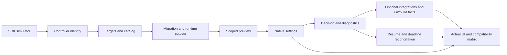

# Product Evolution Implementation Plan

> **For agentic workers:** REQUIRED SUB-SKILL: Use superpowers:subagent-driven-development (recommended) or superpowers:executing-plans to implement this plan task-by-task. Steps use checkbox (`- [ ]`) syntax for tracking.

**Goal:** Довести KGBoard до надёжной индикации IDE после runtime 3.0.0.

**Уточнение объёма от 2026-11-17:** пользователь выбрал узкий IDE-плагин.
[Актуальная граница этапа](2026-11-17-ide-focus-scope.md) сохраняет A/B/C/E,
откладывает D1–D3 и исключает проверки ещё не реализуемого Profile UI.

**Architecture:** Сохраняем один application actor, чистую policy и bounded writer. Вводим идентичность устройств и правила сценариев до UI; объяснения строим в проходе композиции; SDK-интеграции изолируем от core.

**Tech Stack:** JDK25, Kotlin2.4.21, Gradle9.7.0, IntelliJ Platform Gradle Plugin2.20.1, JUnit6.1.3, SDK263.

**Spec:** [Утверждённый дизайн и пять спецификаций](../specs/2026-11-16-product-evolution-design.md).

## Global Constraints

- Диапазон IDE остаётся `263.*`; понижение SDK и поддержка старых IDE не входят в работу.
- Root AGENTS.md остаётся без изменений по исходному указанию пользователя.
- Новые runtime-библиотеки не нужны; UI использует компоненты и темы IDEA.
- Существующие XML storage names и значения читаются без удаления; новые поля имеют явную версию схемы и миграцию.
- Публикация релиза не выполняется автоматически.

## Review Focus

- Перестановка inventory не меняет физическое назначение — A1/A3 и E1.
- Старый UI choice после reconnect отклоняется — A4.
- Delivery acknowledgement не инициирует повторный render — B2.
- Отсутствие optional plugin не ломает core — C1 и E3.
- Сон и перевод системных часов не воспроизводят просроченные эффекты — E2.

---

## Маршрут и точки проверки

Письменный дизайн утверждён пользователем сообщением «поехали». Этот комплект планов
подлежит отдельному чтению перед изменением product code. Старый runtime plan уже
выполнен и не является инструкцией повторить rewrite.

| Порядок | План | Самостоятельный результат |
|---|---|---|
| 0 | [E1: SDK simulator](2026-11-16-product-verification.md#task-e1-версионированный-sdk-simulator-и-настоящие-транспортные-гонки) | Детерминированные TCP-проверки, не входящие в ZIP |
| 1 | [A: настройки и назначения](2026-11-16-settings-experience.md) | Безопасные bindings, typed targets, нативный UI и scoped preview |
| 2 | [B: диагностика](2026-11-16-diagnostics.md) | Причины фактической композиции, доставка, Tool Window |
| 3 | [C: интеграции](2026-11-16-integrations.md) | Optional providers, достоверный Git, общий build observer |
| Отложено | [D: профили](2026-11-16-lighting-profiles.md) | D1–D3 исключены из текущего этапа по выбору пользователя |
| Сквозной | [E2/E3: эксплуатация и матрица](2026-11-16-product-verification.md) | Resume/time, настоящий UI, проверенные IDE и итоговый ZIP |

E3 создаёт UI test tooling вместе с A5 и повторяется после B/C. Проверки Linux
не заменяют Windows/macOS и физическое оборудование. Отсутствие OpenRGB блокирует
только hardware-строки отчёта.



## Где определены общие контракты

Все новые Kotlin-файлы ниже находятся внутри `com.kgboard.rgb`; сокращённые пути
в дочерних планах раскрываются относительно `src/main/kotlin/com/kgboard/rgb/`.
Тестовые пути раскрываются относительно `src/test/kotlin/com/kgboard/rgb/`, если
явно не указан `src/integrationTest/`. Это правила путей, а не новые source roots.

| Контракт | Единственный владелец определения | Потребители |
|---|---|---|
| InventoryToken, DeviceBinding, DeviceResolution, DeviceChoice | A1 | A3/A4/B/E |
| TargetSpec, TargetResolution, GroupDefinition, RuleAppearance, ScenarioCatalog | A2 | A3/A5/B/C/D |
| SettingsMigration, AppDraft, ProjectDraft, rules snapshots | A3 | A4/A5/D |
| PreviewContent, PreviewRequest, PreviewAvailability | A4 | A5/B/D/E |
| LightingDecision, DeviceDecision, RuleVisibility, FrameEnvelope | B1 | B2/B3/D/E |
| DeliveryReceipt, DeliveryState, DiagnosticsSnapshot | B2 | B3/E |
| IntegrationProvider, CapabilitySnapshot, ProviderLease | C1 | C2/C3/B3/E |
| RepositoryFacts, GitSample, GitIndicator | C2 | C3/D/E |
| BuildObservation, BuildRootTracker | C3 | B/E |
| AppearanceTemplate, AppearanceProfile, BrightnessSettings, AnimationPolicy (отложено) | D1/D2 | Не требуются для текущего этапа |
| TimeSample, RuntimeDeadline, ResumeDetector | E2 | reducer/Pomodoro/scheduler |

Смена сигнатуры требует обновить связанные планы и тесты до реализации следующей
задачи. UI и optional adapters не получают транспорт. Не добавлять второй compositor.

## Общие команды и коммиты

Проверенный SDK:
`/home/dzerik/.cache/kgboard-sdk/2026.3/installation/idea-IU-263.7307.200`.
Во всех командах планов `-PlocalPlatformPath` обязателен; ниже полные команды:

```bash
./gradlew test buildPlugin -PlocalPlatformPath=/home/dzerik/.cache/kgboard-sdk/2026.3/installation/idea-IU-263.7307.200 --console=plain
./gradlew verifyPlugin --offline -PlocalPlatformPath=/home/dzerik/.cache/kgboard-sdk/2026.3/installation/idea-IU-263.7307.200 --console=plain
```

Не добавлять второе `-offline` через verifier freeArgs. Перед первым изменением
воспроизвести baseline: 232 теста на `2c7eec0`, Compatible на IDEA263. Если current
branch содержит новые проверки, сравнивать baseline в изолированном worktree.

Каждая задача заканчивается самостоятельным коммитом после GREEN. Перед каждым:
повысить `pluginVersion` в `gradle.properties`, добавить датированную запись текущей
версии в `CHANGELOG.md`, выполнить `git diff --check`. Скрипта bump в проекте нет;
сначала перепроверить это на момент исполнения. PATCH — tests/fixes/internal refactor,
MINOR — включённая пользователю новая функция; несовместимый XML не вводится.
Первый законченный функциональный пакет имеет версию не ниже3.1.0. Конкретная версия
следующей задачи выводится из фактического HEAD, а не из устаревающей таблицы чисел.
Добавлять только перечисленные task files и эти два version files; `git add -A`
не использовать. Не подписывать коммиты AI, не выполнять push/tag/release.

## Сводная приёмка и самопроверка планов

| Требование спецификаций | Задачи / доказательство |
|---|---|
| Все legacy app/project/group fields, blank semantics, unknown IDs | A2/A3, XML round-trip и reflection coverage |
| Serial/location, порт, endpoint, session-only, raw fingerprint | A1/A2/A3/E1 |
| Две области Apply, группы, branch regex/order, переводы | A5, настоящие Configurable fixtures и E3 |
| Preview effect/channel, stale choice, cleanup/in-flight shutdown | A4/B2/D2/E1/E3 |
| Причина цвета, частичное перекрытие, реальные ack, bounded history | B1/B2/B3 |
| Git NUL-safe и cancellation; JPS/Gradle/Maven без двойного producer | C2/C3, actual local projects и SDK fixtures |
| Нет обязательных Java/SM/Git; dynamic unload | C1/E3 |
| Три точных профиля, исключённые поля, local XML, Cancel (отложено) | D1/D2/D3, не входит в текущую готовность |
| Resume, clocks, Pomodoro без catch-up replay | E2 |
| Native UI themes/scale/accessibility, три IDE, итоговый ZIP | E3 |
| Hardware и OS evidence с честными gaps | E3, Blocked/NotRun до фактических наблюдений |

Самопроверка перед handoff: coverage сопоставлено со всеми пятью specs; shared
контракты имеют единственного владельца; все Review Focus строки закреплены тестами;
команды RED/GREEN и version/changelog шаги есть в каждой задаче. Никакая задача
не подразумевает успешное физическое испытание только по snapshot или socket write.
