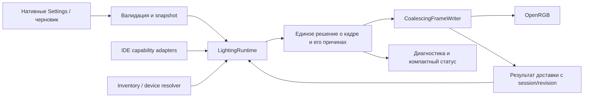

# KGBoard: развитие продукта после runtime 3.0.0

Статус: пользователь утвердил весь предложенный объём; эта письменная спецификация
подготовлена для проверки перед реализацией. База: `2c7eec0`, 232 теста, IDEA263.

## Назначение

Сделать KGBoard понятной, достоверной обратной связью о работе IDE. Пользователь
должен настроить первый сигнал без знания LED-индексов, понимать текущий цвет и
сохранять назначения после переподключения устройства.

## Весь принятый объём

| Пакет | Результат | Подробная спецификация |
|---|---|---|
| A. Интерфейс и назначения | Нативные настройки, именованные клавиши, явные цели, устойчивый выбор устройств | [Settings experience](2026-11-16-settings-experience-design.md) |
| B. Объяснимость | Причина цвета, перекрытые сигналы, состояние доставки и история ошибок | [Diagnostics](2026-11-16-diagnostics-design.md) |
| C. Интеграции | Достоверный Git ahead/behind/conflict; JPS, Gradle и Maven; optional-адаптеры | [Integrations](2026-11-16-integrations-design.md) |
| D. Профили | Минимальный, Отладка, Тихая подсветка; пользовательские варианты и две категории яркости | [Profiles](2026-11-16-lighting-profiles-design.md) |
| E. Проверка | Реальные темы/окна, сон/пробуждение, устройства и матрица IDEA/PyCharm/WebStorm | [Verification](2026-11-16-product-verification-design.md) |

Порядок программной реализации: A → B → C → D. Пакет E сопровождает каждый этап.
Профили следуют за интеграциями, поскольку их project templates используют новые
Git-состояния ahead/behind/diverged. Отсутствие оборудования блокирует только аппаратное подтверждение, а не работу
над остальными пакетами. Следующий функциональный пакет — 3.1.0; дальнейшие MINOR
версии определяются завершёнными пакетами. Каждый git commit соблюдает CLAUDE.md.

## Выбранный подход

Нативные Settings с постоянным контекстом и редактором выбранного сценария лучше
всего продолжают существующий плагин и его атомарный Apply. Отдельное дерево
Configurable для каждой функции уменьшило бы размер страниц, но усложнило бы общий
черновик и предпросмотр. Основное управление в Tool Window удобно для наблюдения,
но требует отдельного места для постоянных настроек. Поэтому настройки остаются
в Settings, а Tool Window используется для диагностики в пакете B.

## Общая архитектура

Сохраняются единственный application runtime, последовательный reducer, чистая
policy и единственный bounded network writer. UI и интеграции не пишут LED напрямую.

Новые границы: `DeviceResolver` отвечает за идентичность, `TargetResolver` — за
клавиши конкретного устройства, `ScenarioCatalog` — за описание правил и форм,
`LightingDecision` — за совпадение видимого кадра с объяснением, integration providers
— за доступность и lifecycle SDK-источников. Все domain snapshots не содержат
Project, PSI, Swing-компонентов и ProcessHandler.

## Совместимость и ограничения

- JDK25, Kotlin2.4.21, Gradle9.7.0, IntelliJ Platform Gradle Plugin2.20.1, JUnit6.1.3.
- Диапазон IDE остаётся `263.*`; понижение SDK и поддержка старых IDE не входят в работу.
- Существующие XML storage names и значения читаются без удаления; новые поля имеют
  явную версию схемы и миграцию. Snapshot conversion покрывает все добавленные поля.
- Root AGENTS.md остаётся без изменений по исходному указанию пользователя.
- Предпросмотр, Disable, focus и shutdown сохраняют правила runtime3.0.0.
- Новые runtime-библиотеки не нужны; UI использует компоненты и темы IDEA.
- Первый cross-IDE набор: IDEA, PyCharm и WebStorm. Другие продукты не объявляются
  поддержанными без отдельной строки в проверенной матрице.
- Локальные standalone IDE входят в объём. Remote Development/JetBrains Client
  требуют отдельного определения, на какой машине находится OpenRGB, и здесь не
  получают заявления о поддержке. Публикация релиза не выполняется автоматически.

## Подтверждённые технические основания

Текущий parser читает, но отбрасывает serial/location. В документации OpenRGB они
есть в controller data; vendor добавлен с protocol1. Новый parser должен правильно
разбирать версии0–5, а серверу6 запрашивать согласованную версию5. Обновление клиента
до protocol6 не требуется. [OpenRGB SDK](https://github.com/CalcProgrammer1/OpenRGB/blob/master/Documentation/OpenRGBSDK.md).

SDK263 содержит публичные `BuildViewManager.addListener`, StartBuildEvent и
FinishBuildEvent. Они являются выбранной основой общего наблюдения за сборками;
фактическое покрытие JPS/Gradle/Maven должно быть доказано integration tests.

Установка в другие IDE зависит от объявленных модулей и plugins. Обязательные
Java/Test Runner зависимости текущего plugin.xml нужно пересмотреть; optional API
не должны загружаться вместе с core. [JetBrains compatibility](https://plugins.jetbrains.com/docs/intellij/plugin-compatibility.html),
[optional dependencies](https://plugins.jetbrains.com/docs/intellij/plugin-dependencies.html).

Официальные release metadata на 2026-11-16 дают IDEA2026.3 build263.7307.200,
WebStorm2026.3 build263.7307.202, PyCharm2026.3 build263.7307.206. Проверка бинарников
двух последних продуктов ещё не выполнена. [Release metadata](https://data.services.jetbrains.com/products/releases?code=IIU,WS,PY&latest=true&type=release).

Локальный `openrgb` не найден; `127.0.0.1:6742` возвращает ConnectionRefused.
Модель устройства, OpenRGB version и внешний SDK endpoint запрошены у пользователя.

## Что считается завершением

Все программные пакеты реализованы, старые fixtures мигрируют без потери значений,
нет старых direct LED paths, unit/platform/UI tests проходят, ZIP собран, Plugin
Verifier проходит на каждой заявляемой IDE. UI-проверка включает настоящие Light/Dark
темы, а не только offscreen-формы fixture. Аппаратные результаты записаны отдельно:
непроведённая проверка остаётся NotRun/Blocked и не превращается в Passed.

На каждый пакет нужен отдельный конкретный implementation plan; каждый производит
самостоятельно проверяемый результат. Спецификации выше описывают весь запрос,
а не исключают поздние пакеты после завершения первого.
