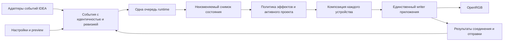

# KGBoard: единая модель состояния и управление подсветкой

Статус: утверждена пользователем 2026-11-16; SDK-база обновлена по последующему запросу пользователя до IDEA 2026.3. Runtime реализован; аппаратная проверка остаётся неподтверждённой (см. `docs/runtime-verification.md`).

## Цель и границы

Переписать управление состояниями KGBoard, чтобы подсветка достоверно отражала
текущую работу IDEA независимо от порядка прихода событий, переключения проектов,
потери фокуса и разрывов подключения. Пользователь подтвердил направление после
аудита; конкретные правила поведения ниже утверждены вместе со спецификацией.

Использовать Kotlin 2.4.21, JDK 25, IntelliJ Platform 2026.3 (build 263.7307.200), диапазон
совместимости 263–263.*, формат существующих XML-настроек, цвета, группы клавиш,
роли устройств и математические функции эффектов. Для runtime новые библиотеки не требуются. Сборка использует IntelliJ Platform Gradle Plugin 2.20.1 и Gradle Wrapper 9.7.0.
Транспорт исправляется в части жизненного цикла и отправки; бинарный протокол
сохраняется. Визуальный редизайн настроек и новые эффекты выходят за границы задачи.

## Рассмотренные подходы

| Подход | Результат и цена |
|---|---|
| Локальные исправления listeners и блокировок | Быстро убирают отдельные симптомы, сохраняют несколько владельцев LED и распределённые правила состояния. |
| Единый runtime с постепенным подключением адаптеров — выбран | Задаёт одну последовательность изменений и один вывод, сохраняет проверенные протокол, настройки и вычисления. Требует миграции источников событий. |
| Полное переписывание плагина и UI | Увеличивает объём и риск регрессий, не даёт дополнительной гарантии правильности состояния. |

## Устройство runtime

Application-level `LightingRuntime` единолично изменяет состояние в выделенной
последовательной очереди. Чистая функция перехода принимает состояние, событие и
монотонное время; возвращает новое состояние и команды окружению. Тесты подменяют
время, планировщик и транспорт, но исполняют те же переходы и политику, что продукт.
Сетевой I/O и PSI-вычисления выполняются вне очереди и EDT; завершения возвращаются
событиями с идентификатором сессии или ревизией запроса.

Адаптеры IDEA сообщают факты, а не цвета. Они не вызывают прямые записи LED.
Существующие project-level менеджеры мигрируют в адаптеры runtime и затем удаляются,
чтобы в окончательной реализации не осталось второго пути управления устройством.

## Независимые состояния

| Область | Представление и правило |
|---|---|
| Подключение | Disconnected, Connecting, Ready, Backoff; отдельные намерение подключения и ревизия сессии. |
| Приложение | Enabled/Disabled, Focused/Unfocused, Running/ShuttingDown. |
| Проекты | Реестр открытых проектов и явно выбранный активный проект. |
| Редактор | Нет редактора, неподдерживаемый редактор, текстовый документ с идентичностью и ревизией. |
| Анализ | Неизвестно, выполняется, готовый результат; отдельно доступность из-за индексации. |
| Операции | Наборы запусков, debug-сессий, сборок и тестовых сессий с идентичностью источника. |
| Эффекты | Слои с владельцем, приоритетом, целью и сроком жизни. |
| Preview | Одна активная сессия с ID, владельцем UI, устройством и сроком действия. |

Не моделировать декартово произведение этих областей одним огромным enum.
Результат асинхронной работы принимается, только если его проект, документ,
ревизия и сессия ещё актуальны. Закрытие проекта удаляет его данные и делает все
его незавершённые результаты неактуальными.

## Правила поведения

### Фокус, проекты и выключение

- Подсветку определяет проект сфокусированного окна IDEA. Смена окна IDEA обновляет
  владельца, даже если приложение в целом не теряло фокус. Закрытие другого проекта
  не записывает idle поверх активного.
- Фоновые проекты продолжают учитывать свои процессы и таймеры, но их эффекты
  становятся видимыми только при выборе этого проекта.
- Если сфокусированного проекта нет, показывается idle. При потере фокуса IDEA
  сохраняется последний активный проект; при `dimOnFocusLoss=true` итог для всех
  включённых устройств — idle с настроенной яркостью, включая время анимаций и preview.
  При `dimOnFocusLoss=false` продолжается обычная композиция последнего проекта.
- Возврат фокуса пересчитывает результат из текущего состояния. Просроченные
  вспышки не воспроизводятся заново.
- Enabled=false завершает preview, убирает эффекты с вывода, один раз отправляет
  idle при доступном соединении, затем останавливает анимационные тики. События
  продолжают обновлять факты. При повторном включении выполняется сверка актуального
  состояния IDEA; старые кратковременные эффекты не возвращаются.
- Shutdown запрещает новые команды, отменяет фоновые задачи, выполняет
  ограниченную по времени финальную запись согласно `resetOnExit` и закрывает транспорт.

### Процессы, приоритеты и таймеры

- Каждый процесс и debug/test-сеанс имеет собственный ID. Завершение A удаляет
  только состояние A; B остаётся активным. При отсутствии ID у SDK-источника адаптер
  документирует и тестирует ограничение наблюдаемости, не выдаёт имя за уникальный ID.
- Для операций различаются запуск, выполнение, завершение, ошибка старта и отмена;
  для debug дополнительно пауза и продолжение. Отмена сборки/тестов не считается
  успехом. Пропущенные/игнорированные тесты не считаются ошибкой; сессия без
  исполненных тестов не выдаёт подтверждение успешного прохождения.
- Тестовый процесс не порождает конкурирующий обычный Run-эффект для той же операции.
  Приоритеты цветов сохраняются; вытесненный активный слой хранится и появляется снова
  после снятия верхнего. Равные приоритеты разрешаются временем создания, затем ID.
- Временный статичный эффект планирует отдельное пробуждение на ближайший deadline.
  Постоянная статика не держит цикл 30 FPS. После истечения или удаления слоя
  следующий кадр формируется независимо от наличия других событий.
- Pomodoro меняет фазу, оставшееся время и поколение одной операцией runtime.
  Время вычисляется от deadline, а не через несинхронизированный decrement. Запоздалый
  tick после stop/skip не меняет новую фазу.

### Файлы, анализ и готовность IDEA

- При старте сначала подключаются наблюдатели, затем сверяется исходное состояние;
  гонка между подпиской и снимком разрешается ревизиями и повторной сверкой.
  Уже запущенная индексация видна сразу.
- Обрабатываются выбор вкладки, закрытие, отсутствие редакторов, удаление документа
  и переход в нетекстовый редактор. Результат предыдущего документа снимается сразу.
- Анализ и предупреждения относятся к выбранному документу. Пока нет достоверного
  результата для его текущей ревизии, зелёный clean не показывается. Изображения,
  бинарные и неподдерживаемые редакторы дают «не применимо», а не «ошибок нет».
  Индексация даёт отдельное состояние доступности анализа.
- Тип файла служит проверкой применимости возможностей PSI, а не фиксированным
  whitelist расширений. Обычный текстовый файл может поддерживать TODO без поддержки
  инспекций; отсутствие инспекций не трактуется как успешный анализ.
- Смена документа/содержимого инвалидирует предыдущие результаты. Завершение старого
  анализа не возвращает индикатор прежней вкладки.
- Git остаётся состоянием проекта; TODO относится к выбранному файлу. Настройки
  включения не определяют создание подписок. Apply немедленно пересчитывает политику
  и снимает выключенные индикаторы.
- Вспышка сохранения возникает при сохранении изменённых документов проекта.
  Пустой save-all не создаёт вспышку; источник события не считается доказательством Ctrl+S.

### Подключение и устройства

- Ошибка чтения/записи закрывает транспорт, инвалидирует Ready и кеш отправленных
  кадров. `Socket.isConnected` не является проверкой работоспособности сессии.
- Каждая попытка подключения и операция вывода связана с ревизией сессии. Результат
  старой попытки после Disconnect, смены host/port или shutdown игнорируется.
  Ручной Disconnect отменяет retries; Connect снимает этот запрет, а Auto-reconnect
  управляет повторными попытками после ошибки транспорта.
- После Ready заново обнаруживаются устройства и mapping; текущий кадр отправляется
  принудительно. Изменение устройства на Apply также обновляет mapping и группы.
  Ready без подходящих устройств отображается как подключение без доступного
  устройства; попытки рисования не создают ошибки индекса или ложного успеха Test.
- Dirty-check и композиция выполняются отдельно для каждого устройства. Все роли
  используют одинаковые правила приоритетов. Кеш обновляется после успешной записи
  в транспорт, а не постановки задачи в очередь.
- Очередь кадров ограничена: ожидающий кадр устройства заменяется более свежим.
  При медленном сервере не накапливается история 30 FPS.
- Существующий индекс устройства сохраняется ради совместимости настроек.
  В UI показываются имена обнаруженных устройств; недоступный индекс даёт явную
  ошибку. Устойчивая идентификация между перезапусками сервера требует отдельной
  миграции и не обещается в этой переработке.

### Настройки и preview

- Настройки применяются одним неизменяемым снимком; Cancel оставляет сохранённую
  конфигурацию прежней. Connect и Test получают текущий валидный черновик явно.
  Отмена диалога завершает preview и возвращает endpoint и намерение подключения,
  действовавшие до открытия диалога, если диагностическое подключение их изменило.
  Ранее отключённое соединение при Cancel автоматически не включается.
- Preview — временный слой runtime, не глобальный флаг paused. Он привязан к ID UI
  и исходному устройству. Повторный Test заменяет слой; закрытие Settings, Disconnect,
  Disable и смена устройства завершают его и пересчитывают обычный кадр.
- Для выбранных LED preview изменяет только выбранные LED; остальные сохраняют
  обычную композицию. Пустое поле явно означает все LED; непустой некорректный ввод
  не превращается во все LED. Индексы проверяются по обнаруженному устройству.
- UI показывает Connecting, Connected, Disconnected, Retry и причину последней
  ошибки. Для анализа различимы ожидание, индексация, результат и неприменимость.

## Проверка и критерии приёмки

Сначала перенести четыре диагностических воспроизведения аудита в постоянные
регрессионные тесты через интерфейс нового runtime. Далее использовать управляемое
время и принудительные перестановки завершений фоновых задач. Тесты обязаны проверять
фактически отправленные кадры и их владельцев, а не только внутренние поля.

Обязательные последовательности:

1. Static и animation: focus → blur → tick → focus; затем смена активного проекта.
2. Два проекта: оба работают → закрытие фонового → возврат к оставшемуся.
3. Два Run, Run+Debug, Debug+Tests: оба порядка завершения и восстановление вытесненного.
   Также ошибка старта, отмена, debug pause/resume/stop и пустая тестовая сессия.
4. Временный Static: deadline наступает без внешних событий, вывод возвращается к основе.
5. Test → Cancel/OK/повторный Test/смена устройства/Disconnect/Disable.
6. TCP reset → write failure → reconnect; Disconnect во время Connect; старое завершение
   отправки после нового соединения; ограниченность очереди при медленном сервере.
7. Перекрытый primary и изменившийся indicator; приоритеты пересекающихся targeted-слоёв.
8. Файл с TODO/ошибками → уже открытый чистый файл → изображение → закрытие последней вкладки;
   завершение анализа старого файла после переключения и изменение документа во время анализа.
9. Старт в dumb mode → smart mode; enabled off/on и Apply отдельных функций в обоих направлениях.
10. Pomodoro tick одновременно со stop/skip; dispose проекта при незавершённых вычислениях.

Полная проверка: `JAVA_HOME=/usr/lib/jvm/java-25-openjdk-amd64 ./gradlew test buildPlugin`
и `verifyPlugin` на заявленном диапазоне платформ. Детерминированные тесты дополняются
ручной проверкой в sandbox IDEA с OpenRGB; отсутствие оборудования явно отмечается.

## Порядок миграции

1. Зафиксировать исходное состояние и воспроизводимые дефекты; проверить baseline.
2. Создать чистую модель, переходы, политику, управляемые время и команды вывода.
3. Подключить один application-level writer и исправленный жизненный цикл транспорта.
4. Перевести адаптеры фокуса, проектов и операций, затем файлов, анализа и таймеров.
5. Перевести Apply и preview; удалить старые прямые записи и project-level render loops.
6. Выполнить сценарную, платформенную и ручную проверку; обновить документацию.

Каждый этап проверяем отдельно, но переключение продукта на новый runtime выполняется
атомарно: старый и новый writer не работают одновременно. По проектному правилу о
крупных архитектурных изменениях целевая версия реализации runtime — 3.0.0; версия 2.0.0 отведена
миграции на SDK IDEA 2026.3 с повышением минимальной версии IDE. Бинарная совместимость XML-конфигурации сохраняется.
