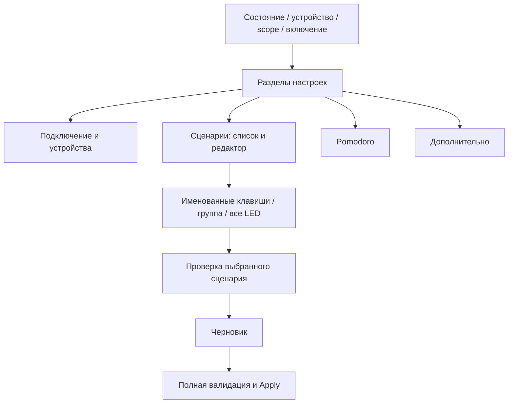

# KGBoard: интерфейс, цели подсветки и устройства

Статус: письменный дизайн пакета A утверждён пользователем. Общие ограничения и весь объём:
[product evolution](2026-11-16-product-evolution-design.md).
Основание: [UX/UI-аудит](../../ux-ui-audit.md).

## Результат для пользователя

При доступном OpenRGB первый результат получается за три содержательных действия:
выбрать устройство по имени, выбрать цель, запустить проверку. После этого Apply
сохраняет конфигурацию. Не нужно искать LED-индексы или разбираться в protocol flags.

## Структура настроек

Существуют две явно подписанные области: «Для всех проектов» и «Для проекта <name>».
Настройки проекта используют тот же редактор сценария, но собственный draft и Apply.
Открытый редактор не меняет свой project scope при переключении активного окна.

Над содержимым каждой страницы постоянно видны:

- состояние OpenRGB, имя устройства и доступность назначений;
- область сохраняемых настроек;
- переключатель интеграции и ссылка на диагностику;
- состояние preview, когда он запущен.

В app-настройках четыре раздела: «Подключение и устройства», «Сценарии подсветки»,
«Pomodoro», «Дополнительно». Сценарии внутри раздела выбираются в списке слева;
справа редактируется один сценарий. Project-настройки содержат Git, анализ и shortcuts.
Текст интерфейса использует resource bundle; базовый язык English, добавлена Russian
локализация. Строки привязаны к locale IDE, язык и шрифты не задаются вручную.

«Подключение и устройства» показывает обнаруженные устройства, а не редактируемые
индексы. Добавление роли выбирает устройство из inventory. Роли объясняются как
«Все события», «Только индикаторы», «Фоновая подсветка», «Те же события на другом
устройстве». Последняя роль рассчитывает клавиши по собственной геометрии устройства.

Host/port находятся в раскрываемых параметрах сервера. Compatibility-настройка
skipCustomMode сохраняет значение и объясняется через поведение устройства. Пустое
inventory имеет причину и действие; ошибка подключения предлагает повторить попытку
или проверить SDK server. Переподключение и остановка retry — явные команды.

## Единый каталог сценариев

`ScenarioCatalog` описывает стабильный ID, scope, название, доступность, варианты
состояния, цвета, цель и канал яркости. UI и policy читают один каталог настроек.
Ручная сборка отдельных форм и повторное перечисление сценариев в UI исключаются.

Группы: Build, Run, Debug, Tests, File Save, Indexing, Low Memory, TODO, Pomodoro;
project-группы: Git Status, Git Branch, Analysis, Shortcuts. Внутри группы отдельные
правила имеют стабильные IDs, например build.progress/build.success/build.failure.
Можно выключить промежуточный сигнал, сохранив результат: это нужно профилям.

Редактор показывает включение, цель и строки доступных состояний с цветом и Preview.
Смысл эффекта объясняется обычным текстом. Duration/period — в секундах; внутренний
snapshot по-прежнему хранит миллисекунды. Расширенные значения и приоритеты не
занимают основной сценарий настройки. Приоритеты renderer не редактируются пользователем.

## Явная модель цели

В runtime вводятся значения `All`, `NamedKeys`, `Group`, `RawIndices`, `Unassigned`.
Включение правила хранится отдельно; Unassigned означает, что включённое правило
ждёт назначения, а не что оно выключено. Пустой ввод никогда не преобразуется в All.

- All означает все LED данного устройства, включая новое количество LED после reconnect.
- NamedKeys хранит имена, а не текущие индексы. Поиск и выбор клавиш показывают
  исходные OpenRGB names; нормализованные aliases используются только без неоднозначности.
- Group хранит ID встроенной или пользовательской группы, а не её временное разрешение.
- RawIndices доступен в расширенном редакторе. Требуются непустые валидные числа;
  malformed, отрицательные, overflow и выход за известный диапазон отвергаются.
- Unassigned ничего не подсвечивает и даёт видимый запрос выбрать цель.

`TargetResolver` возвращает indices, missing keys и состояние
Resolved/Partial/Unavailable/Ambiguous. Нет подстановки All при ошибке. Частичная
именованная цель использует только однозначно найденные клавиши и показывает N из M.
При нуле найденных LED Preview недоступен. Сохранение валидной цели для offline
устройства разрешено с пометкой о непроверенном разрешении.

При наличии zone matrix допускается схема клавиатуры; обязательный и полноценный
fallback — список именованных LED с поиском. Отсутствующая геометрия не заменяется
выдуманной QWERTY-картинкой. Пользовательские группы можно создавать, переименовывать
и удалять. Built-in IDs и UUID пользовательских групп имеют разные namespaces; имя
не является identity группы. Ссылки на удалённую группу становятся Unassigned с объяснением.

## Устойчивая привязка устройства

Parser сохраняет serial, location и display names, которые сейчас отбрасываются.
`DeviceBinding` имеет собственный UUID, endpoint scope и признаки устройства.
Индекс из inventory — только результат разрешения в текущей сессии.

Порядок сопоставления:

1. Уникальный непустой serial вместе с type/vendor. Известные фиктивные и уже
   обнаруженные дублирующиеся serial не считаются сильной идентичностью.
2. Для слабой идентичности — явная привязка к location вместе с type/vendor/name.
   UI показывает, что назначение зависит от порта.
3. Несколько кандидатов или отсутствие совпадения дают Ambiguous/Missing. Запись
   блокируется для этой привязки до выбора пользователя. Старый index не используется.

При отсутствии serial/location явный выбор действует только до конца текущей
сессии; новое соединение снова требует подтверждения. Кандидаты с одинаковыми
metadata не различаются искусственным порядковым номером.
Изменение endpoint требует выбора устройства для этого сервера. Можно перепривязать
missing устройство, сохранив сценарии; две enabled роли не управляют одним resolved
устройством одновременно. Смена имени при сильной serial-идентичности не теряет binding.

Отдельный ordered layout fingerprint включает имена LED и структуру зон, но не цвета.
NamedKeys/Group разрешаются заново после каждого нового inventory. RawIndices привязаны
к fingerprint: после изменения раскладки они не записываются до подтверждения.
Новый session/device mapping revision инвалидирует также shortcuts и старые read results.
Idle, Disabled и shutdown тоже используют разрешённый binding, без обхода через legacy index.

## Миграция XML

Старые State fields и storage names сохраняются. Новые поля schemaVersion, bindings,
target definitions и rule flags добавляются с defaults. Persisted mutable DTO и
immutable runtime DTO разделены; неизвестные IDs сохраняются, но не исполняются.

Миграция идемпотентна и не повышает schemaVersion до успешного сохранения полного
результата. Цвета, duration, pulse, focus, auto-connect и skipCustomMode не сбрасываются.
Однажды появившийся DeviceBinding имеет приоритет над legacy index.

Правила для пустых legacy CSV повторяют фактическую policy3.0.0, а не старые подсказки:

| Поля | Пустое значение мигрирует в |
|---|---|
| Build, Execution, Test, Save, Breakpoint, Pomodoro | All |
| Low Memory | All |
| Indexing, TODO, project Git Status, Analysis | Unassigned |
| Git Branch | Существующая background-цель All, независимо от Git Status target |

Непустые CSV становятся RawIndices; ошибочный ввод сохраняется для исправления и
не исполняется. Старые numeric user groups получают такую же проверку fingerprint.
Если старый конфиг знает только index, при первом запуске обновления нужно один раз
подтвердить устройство: восстановить отсутствовавшую идентичность автоматически
невозможно. До подтверждения можно подключаться и смотреть inventory, но legacy
назначения не записываются в случайное устройство.

Чтение старой конфигурации совместимо. Возврат к3.0 использует legacy-поля и игнорирует
новые профили/цели; полное совпадение поведения downgrade не обещается.

## Draft, Apply и preview

Swing-компоненты создаются только в createPanel на EDT. Отдельный SettingsDraft
живёт до закрытия Settings. Reset меняет draft; managed State не изменяется до Apply.
App и Project scope валидируются и применяются независимо, без скрытой записи в другой scope.

Apply сначала собирает и валидирует весь draft, затем заменяет persisted state и
передаёт один immutable snapshot. Ввод в незавершённой ячейке таблицы учитывается.
Правила веток переставляются; regex проверяется на текущем или введённом имени ветки.

Предпросмотр сценария использует draft-правило с его эффектом, каналом яркости и
целью, а не только статичный цвет. Device Test — отдельная двухсекундная статичная
проверка белым цветом на30% яркости, чтобы первое действие было различимо с idle.
Все варианты выполняются через один scoped preview runtime.

Preview доступен, если runtime enabled, ready session актуален, выбранное устройство
однозначно и цель содержит хотя бы один LED. Причина недоступности показана рядом.
Если включение KGBoard ещё только в draft, предлагается сначала применить его.
Проверка получает текущие draft device/target/color и UI id. Начало, отмена и конец
видны; повторный Preview заменяет предыдущий. Диагностический Connect использует draft
endpoint. UI choice хранит session/inventory revision, с которой список был показан;
click после смены inventory не получает автоматически новую revision со старым index.
Устаревший Preview отклоняется с предложением обновить выбор.
Cancel/Apply/Disconnect/Disable/смена устройства/shutdown сохраняют cleanup3.0.0.
Preview возвращает обычную композицию KGBoard; восстановление аппаратной анимации
другого OpenRGB-клиента не является обещанием этого пакета.

## Критерии приёмки

- Старые app/project/groups fixtures читаются без потери параметров; blank semantics
  мигрируют по таблице; повторная миграция не меняет результат.
- Перестановка двух устройств, одинаковые serial, отсутствие serial, смена порта,
  endpoint и числа LED не направляют кадр на неподтверждённое устройство.
- При перестановке клавиш с тем же numLeds первый кадр не использует старые indices.
- All/NamedKeys/Group/RawIndices/Unassigned дают одинаковый смысл во всех формах.
- Test недоступен с конкретной причиной при отключении/ошибке/неизвестной цели;
  закрытие Settings всегда завершает его, включая preview-only устройство.
- Общая форма и project-форма используют один редактор, переводы и validation.
- Native Light/Dark, viewport900×700, масштабы100/150/200%, keyboard navigation:
  нет пересечений текста, кнопок и скрытых непроверяемых controls.
- В целевых UI-сценариях не требуется вводить LED-индексы; advanced CSV остаётся доступен.
