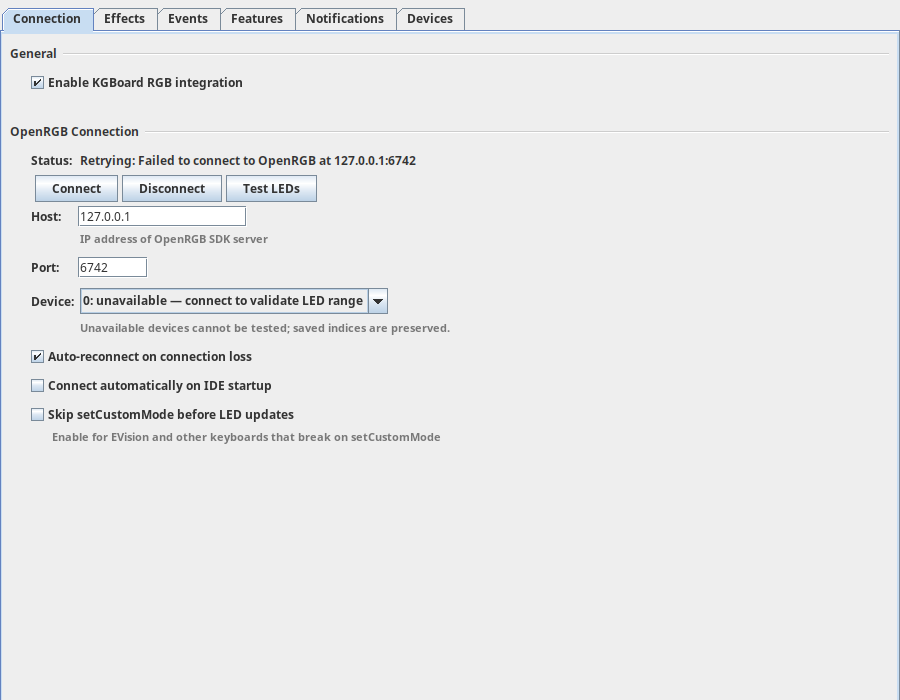
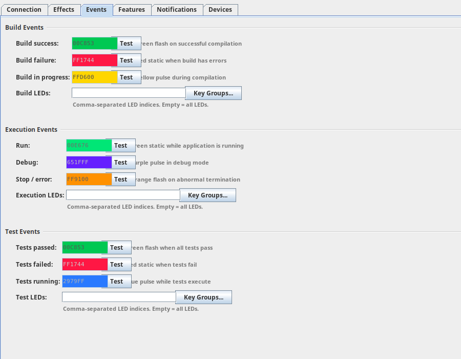
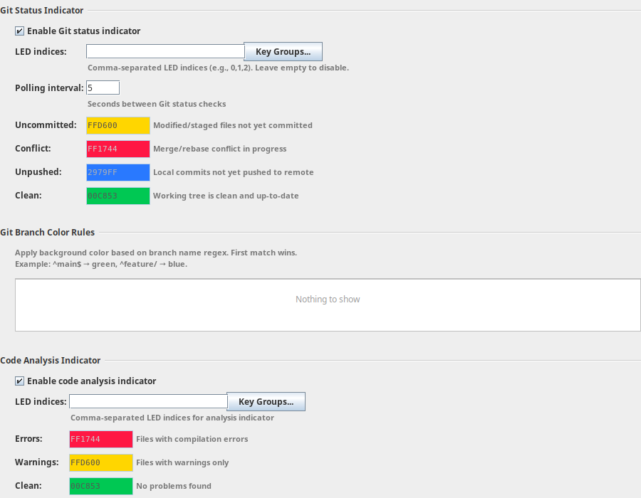
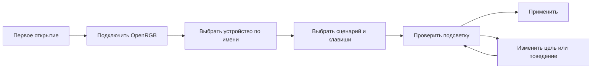

# UX/UI-аудит KGBoard

Дата: 2026-11-16. Проверена реализация runtime3.0.0 и существующий интерфейс настроек.
Вывод: исправление состояния приложения не решает неудобство его настройки.
Нужна переработка пользовательских сценариев и структуры формы.

## Что действительно проверено

Разобраны первый запуск, подключение/ошибка/retry, выбор устройства, назначение LED,
Test, Apply/Cancel, настройки проекта, multi-device и status widgets. Получены13
offscreen-рендеров: шесть вкладок900×700 и1200×900, страница проекта900×700.
Проверены связи UI-контролов с runtime и валидацией; использованы SDK263 fixtures.

Это экспертный аудит, не исследование с пользователями. Fixture использует системный
Swing Look&Feel: нативная тема IDEA в нём не загружается. Поэтому визуальные наложения
и контраст ниже являются сигналами для проверки в реальной Light/Dark теме, а не
подтверждением идентичного вида рабочего IDE. В настоящем Settings диалог добавляет
внешний scroll pane; обрезание raw-компонента на рендере само по себе не доказывает
отсутствие прокрутки. Физическое устройство не проверялось.

## Проблемы, подтверждённые сценариями и кодом

| Приоритет | Проблема | Последствие | Направление исправления |
|---|---|---|---|
| P1 | Нет первого понятного маршрута: сервер, устройство, LED и эффекты настраиваются разрозненно | Пользователь не понимает, как получить первый рабочий результат | Подключение → именованное устройство → понятный вариант подсветки → проверка |
| P1 | Шесть вкладок: Connection, Effects, Events, Features, Notifications, Devices | Категории пересекаются: уведомление тоже событие и эффект; поиск функции непредсказуем | Структура по задачам пользователя, единый редактор сценария |
| P1 | Основной способ выбора клавиш — CSV с нулевыми LED-индексами | Нужно знать внутреннюю нумерацию OpenRGB; настройка повторяется вручную для каждого события | Выбор клавиш/именованных групп; CSV только в расширенном режиме |
| P1 | Пустое поле в app означает «все LED», а в Git — «выключено» | Одинаковое действие даёт противоположный эффект; включённый Git indicator по умолчанию ничего не показывает | Явные состояния цели и отдельное включение функции |
| P1 | Статус соединения и выбранное устройство видны только на Connection | На Events/Features непонятно, куда отправляется Test и почему он не работает | Постоянный компактный контекст: состояние, устройство, область настроек |
| P1 | Test доступен при недоступном устройстве; проверка заканчивается popup, при глобальном Disable runtime игнорирует preview | Действие выглядит доступным, но результата нет либо появляется повторяющееся сообщение | Состояния доступности кнопки и объяснение рядом; видимые начало/окончание preview |
| P1 | У project Git/Analysis нет такой же проверки цвета/цели, как у app-событий | Для проверки настройки надо искусственно создавать ошибку или Git-состояние | Одинаковый механизм предпросмотра для всех сценариев |
| P1 | В branch rules «first match wins», но перемещение строк отключено | Приоритет правила нельзя изменить понятным прямым действием | Доступная перестановка правил и проверка выражения на имени ветки |
| P2 | Multi-device требует ручных index/name и технических role | Найденные устройства не помогают заполнить таблицу; легко выбрать неверное | Добавление из обнаруженных устройств, имена и описание роли обычными словами |
| P2 | Пустые таблицы показывают «Nothing to show» | Нет объяснения, что добавить и как начать | Причина пустого состояния и одно явное действие |
| P2 | Skip setCustomMode и миллисекунды вынесены рядом с основным подключением | Диагностические детали занимают внимание при первом запуске | Раздел «Дополнительно / Совместимость», понятные единицы и названия |
| P2 | Status bar выводит полный текст подключения/ошибки; нажатие сразу переключает соединение | Шумная строка состояния и неочевидное действие | Краткий статус; подробности и явные команды в popup |
| P2 | Нет объяснения текущего видимого цвета и причины его смены | Даже корректный приоритет воспринимается как случайная смена подсветки | Краткое объяснение активного сценария и временно перекрытых сигналов |
| P2 | Swing-компоненты создаются в конструкторах Configurable | SDK допускает создание Configurable в background thread | Создание компонентов в createPanel с единым UI lifetime |

P1 означает препятствие основному сценарию либо неоднозначное действие. P2 — существенная
понятность/качество интерфейса. Эти оценки относятся к UX; они не означают, что весь
этот перечень уже исправлен runtime-рефакторингом.

## Визуальные свидетельства

Контекст подключения занимает отдельную вкладку; техническая совместимость показана
на одном уровне с основной настройкой. Название недоступного устройства превращается
в длинное служебное сообщение.

Повторяющиеся цвет/Test/CSV/Key Groups не складываются в единый редактор сценария.
В fixture видны наложения Test на начало описания и слабая читаемость некоторых HEX
на заливке; это надо повторно проверить с нативной темой и масштабированием.

На проектной странице снова используется другая структура тех же сущностей. Пустое
LED-поле выключает Git, хотя включающий checkbox отмечен. Таблица regex не объясняет
первое действие; часть функций требует прокрутки.

## Предложение для следующего UI-прохода

Это предложение, не реализованный и не утверждённый редизайн.

1. Постоянная строка контекста: состояние OpenRGB, выбранное устройство по имени,
   «Для всех проектов» / «Для этого проекта», явное включение интеграции.
2. «Подключение и устройства»: один простой сценарий подключения; серверные параметры
   и совместимость раскрываются при необходимости. Устройства выбираются из обнаруженных.
3. «Сценарии подсветки»: список задач слева, детали выбранной задачи справа.
   Сборка, Run/Debug, тесты, качество кода, Git, системные сигналы используют общий редактор:
   включено, цель, цвета/поведение и один понятный предпросмотр.
4. Цель показывает именованные клавиши и группы; внутренние индексы скрыты в advanced.
   «Все клавиши», «Выбранные клавиши» и «Выключено» не кодируются одним пустым полем.
   Реализация должна явно решить совместимость этих режимов со старым XML.
5. Pomodoro получает самостоятельную страницу с фазой, оставшимся временем и командами.
   Тайминги эффектов, dim, shutdown и OpenRGB compatibility находятся в «Дополнительно».
6. Нативные компоненты IDEA, интервалы и цвета темы. Без собственного web-дизайна,
   декоративных dashboard-карточек и отдельной системы шрифтов.

## Критерии приёмки редизайна

- Первый результат после доступного SDK-сервера получается без знания LED-индексов.
- На любом экране понятно, какое устройство и какая область настроек изменяются.
- У Test есть недоступное/идёт проверка/завершено состояния и понятная причина отказа.
- Cancel не меняет сохранённые параметры; состояние preview видно и всегда завершается.
- Включённый сценарий с неназначенной целью явно просит выбрать клавиши, а не молчит.
- Проверены реальные Light/Dark темы, клавиатурная навигация, масштабирование и небольшой
  Settings viewport; текст не пересекается с кнопками.
- Ошибки подключения дают следующий шаг, пустые таблицы — действие добавления.
- Изменение device index после перестановки устройств не выдаётся за устойчивую идентичность.

Рекомендации по empty states и контекстной помощи соответствуют
[JetBrains Empty State](https://plugins.jetbrains.com/docs/intellij/empty-state.html) и
[Context Help](https://plugins.jetbrains.com/docs/intellij/context-help.html).
Жизненный цикл Configurable и внешний scroll pane описаны в
[Settings Guide](https://plugins.jetbrains.com/docs/intellij/settings-guide.html).
